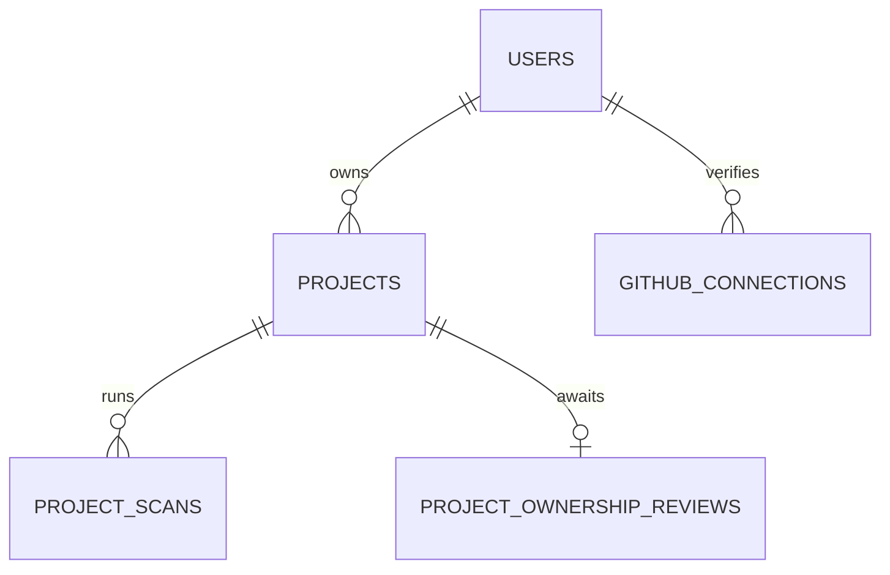
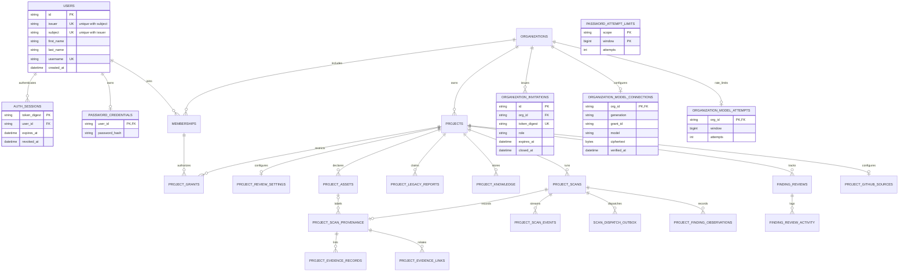
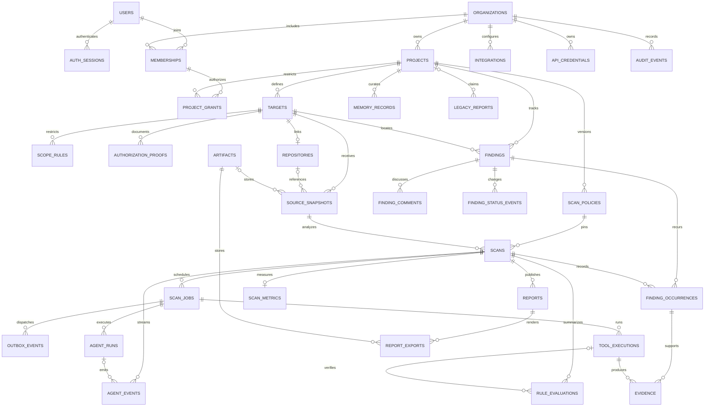

# نموذج بيانات مرصد

## ملكية المشاريع الشخصية · Phase 13

| السجل | التغيير |
|---|---|
| `projects` | `owner_user_id` يشير إلى `users.id`، مع فهرس للمالك والحذف. `updated_at` لحفظ وقت التعديل، و`deleted_at` لإخفاء المشروع والأدلة التابعة له عند الحذف. |
| `project_ownership_reviews` | يسجل المشروع الملتبس وسبب الحجز وتاريخه. قرار المسؤول يسجل مرجع الموافقة ووقت الحل، ولا يظهر هذا الجدول لحساب التطبيق. |
| `github_connections` | سجل التأسيس من المرحلة ١٣. يبقى متاحًا للقراءة حسب المالك. تفويض GitHub الشخصي الحالي يُحفظ في الجدولين الموضحين أدناه. |
| `personal_github_states` | صف مؤقت لكل مستخدم. يحمل بصمتي state والجلسة، وPKCE verifier مشفّر، ووقت انتهاء. يُستهلك مرة واحدة. |
| `personal_github_grants` | صف لكل مستخدم يحمل معرّف حساب GitHub، ومعرّف نسخة الاتصال، ورمزًا مشفّرًا، ووقت انتهاء. الفصل يحذف الصف وطلب التفويض الجاري. |
| `organizations.personal_owner_id` | صف توافق فريد للحساب الذي ينشئ مشاريعه في النسخة الشخصية. يظل `org_id` مطلوبًا في العلاقات المركبة الحالية، بما فيها الوظائف والتقارير والأدلة السابقة. |

الترحيل `platform_personal_0012` يربط المشاريع غير المشتركة بمالك نشط واحد. المشاريع المشتركة أو التي تعذّر تعيين مالكها تُستبعد من مسار الحساب الشخصي إلى حين قرار موثّق. يحافظ الترحيل على معرّفات ومحتوى التقارير وعلاقاتها، ويضيف سياسة مقيّدة بالمالك على الجداول التابعة للمشروع. عند حذف المشروع من الواجهة، تلغى المهام المنتظرة والجارية ويُزال مصدرها الخام، وتظل السجلات التاريخية محفوظة خارج العرض العام إلى أن تُحدَّد سياسة الحذف النهائي. [تشغيل الترحيل](PLATFORM.md#تفعيل-المشاريع-الشخصية--phase-13)

## نموذج النسخة السابقة

المختبر المجهول يستخدم SQLite لتخزين `sessions(owner)` و`reports(id, owner, created_at, model, finding_count, report_json)` و`report_index(id, summary_json)`. قاعدة PostgreSQL تخص المشاريع. المخطط المنفذ أدناه يغطي [Phase 4](../work/plan.md#phase-4) لحد [Phase 10](../work/plan.md#phase-10)، وبعده النموذج المنطقي للتوسعات.

## مخطط PostgreSQL المنفذ

| الجزء | الجداول والمصدر |
|---|---|
| الهوية | `users` و`auth_sessions` و`organizations` و`memberships` و`projects` و`project_grants`، في `platform_identity_0001`. |
| الحساب المحلي | `password_credentials` يربط المستخدم ببصمة Argon2id، و`password_attempt_limits` يفرض سقفًا للمحاولات. الاتنين بيضافوا في `platform_password_0005`. |
| البروفايل | `platform_profiles_0009` يضيف `first_name` و`last_name` و`username` على `users`. اسم المستخدم الاختياري فريد، وتاريخ الإنشاء من `created_at` الحالي. |
| استيراد GitHub | `project_github_sources` في `platform_github_0010` يربط مشروعًا بتثبيت ومستودع. معرّف الاتصال والـSHA مثبتين في بيانات الفحص. |
| ربط الأدلة | `project_evidence_links` في `platform_evidence_links_0011` يربط سجلّي منشأ في نفس المشروع. الثنائية فريدة، و`created_by` يحدد مالك إجراء الربط. |
| الدعوات | `organization_invitations` تحفظ بصمة رمز فريد ودورًا وتاريخ انتهاء وإغلاقًا. الترحيل `platform_invitations_0007`. |
| اتصال الموديل | `organization_model_connections` و`organization_model_attempts` لكل مؤسسة. الترحيل `platform_models_0008` يضيف لحظة بدء استدعاء الموديل في `project_scans`. |
| تشغيل الفحص | `project_scans` يخزن المدخل مؤقتًا ورقم المحاولة والـlease والنسخة النهائية والفهرس المختصر. `project_scan_events` يسجل تسلسل الأحداث، و`scan_dispatch_outbox` يسجل عناوين التسليم. |
| السياسة والذاكرة | `project_review_settings` للإعدادات الحالية، ونسخة السياسة بتتثبت في كل فحص. `project_knowledge` للمراجع المنقّحة، و`project_finding_observations` لتكرار الأدلة. |
| تتبع المصادر والأدلة | `project_assets` مرجع معلن، `project_scan_provenance` بصمة لقطة ونسخة نطاق وقواعد وأدوات، و`project_evidence_records` مواضع أدلة منقّحة وبصماتها. `platform_provenance_0006` يضيف مهلة المدخل الخام. |
| توافق SQLite | `project_legacy_reports` يحتفظ بنسخة التقرير اللي اتربط بمشروع مع المعرّف الأصلي. |

جداول المشروع السابقة بتتضاف في `platform_runtime_0002`. جداول التشغيل والذاكرة والتقارير المرتبطة عليها RLS بمفاتيح المؤسسة والمشروع. حساب الـDispatcher عنده قراءة وتحديث الـoutbox. مرحلة التقارير بتضيف `finding_reviews` للحالة و`finding_review_activity` لسجل التغييرات والتعليقات في الترحيل `platform_review_0003`، والترحيل `platform_observation_0004` يوحّد بصمات الملاحظات القديمة مع المراجعة. الجداول الجديدة كمان عليها RLS. [تشغيل المنصة](PLATFORM.md)

`password_attempt_limits` يعتمد على مفتاح مشتق من الإجراء والإيميل أو عنوان الطرف، وعلى نافذة ١٥ دقيقة. مفيش FK للمستخدم لأن المحاولات بتتحسب كمان لما الحساب غير موجود. `auth_sessions` يخزن بصمة رمز الجلسة ويمنع استخدامها بعد الإلغاء أو الانتهاء.

الدعوة فريدة بالبصمة، ومعاها فهرس مؤسسة وانتهاء. قفل صف المؤسسة بيمنع استهلاك نفس الدعوة مرتين وبيسلسل الإبطال والقبول. جداول الاتصال والمحاولات متعزلة بـRLS مرتبطة بمعاملة المؤسسة. قيمة المفتاح مشفرة بـAES-GCM ومربوطة بهوية المؤسسة وجيل الاتصال. منح المشروع محفوظ في السياسة بمعرّف منح مستقل عن جيل التدوير. بوابة الموديل تستخدم دور قاعدة بيانات محدود بتنفيذ دالتين فقط.

## النموذج المنطقي للتوسعات

## المفاتيح والحقول

الـPK هو `id` من نوع UUID ما لم يُذكر غير كده. المفاتيح المرتبطة تُكتب باسم الجدول المرجعي. الطوابع الزمنية `timestamptz` بتتخزن UTC. الحقول اللي عليها `?` تقبل NULL. جداول المشروع ونسلها تحمل `org_id, project_id`، وجداول المؤسسة تحمل `org_id`. جداول Users وAuth Sessions هوية عالمية، والوصول للمشاريع يمر عبر العضوية.

| جدول | المفاتيح والمحتوى |
|---|---|
| users | `issuer, subject` مفتاح أعمال فريد، `display_name, disabled_at?`. |
| organizations | `slug UNIQUE, name, created_at, retention_policy`. |
| memberships | PK `(org_id,user_id)`، و`role,status,joined_at`. اربط عمليات العضو بهويته الموثقة مع الاحتفاظ بالسجل عند الإبطال. |
| auth_sessions | `user_id → users, token_digest UNIQUE, created_at, expires_at, revoked_at?, last_used_at`. |
| projects | `org_id → organizations, slug, name, archived_at?`. فريد `(org_id,slug)`. |
| project_grants | PK `(org_id,project_id,user_id)`، مع FK للمشروع وFK `(org_id,user_id) → memberships` و`granted_at,revoked_at?`. العضوية والإذن لازم يكونوا صالحين معًا. |
| targets | `project_id → projects, kind, canonical_ref, label`. فريد `(org_id,project_id,kind,canonical_ref)`. |
| scope_rules | `target_id → targets, version, input_kind, allowed, criteria, effective_at`. سجّل fingerprint القائمة النافذة في scan. |
| authorization_proofs | `target_id → targets, actor_id → users, method, state, reference_digest, verified_at?, expires_at?, revoked_at?`. |
| integrations | `provider, external_ref, secret_ref?, state, config_version`، وإعداد منقّح. |
| api_credentials | `actor_id → users, integration_id? → integrations, secret_ref أو token_digest, scopes, expires_at?, revoked_at?`. استخدم مرجع خزنة لسر مزوّد خارجي وhash للتوكن الصادر من المنصة. |
| artifacts | `project_id → projects, object_key UNIQUE, media_type, bytes, sha256, created_at, expires_at?, deleted_at?`. |
| repositories | `target_id → targets UNIQUE ضمن المشروع, integration_id? → integrations, external_repo_id, default_ref`. رابط قراءة لإنشاء snapshot بطلب المستخدم. |
| source_snapshots | `target_id → targets, repository_id? → repositories, artifact_id? → artifacts, submitted_by → users, input_kind, sha256, commit_sha?, ingestion_status, captured_at?`. |
| scan_policies | `project_id → projects, version, ruleset_digest, limits, rules_config, created_by → users`. فريد `(org_id,project_id,version)`. إصدار ثابت بعد الاستخدام. |
| scans | `source_snapshot_id → source_snapshots, policy_id → scan_policies, authorization_proof_id? → authorization_proofs, requested_by → users, scope_digest, model_config, status, idempotency_key, request_digest, created_at, finished_at?`. فريد `(org_id,requested_by,idempotency_key)`، وتعارض المحتوى لنفس المفتاح يرجع 409. |
| scan_jobs | `scan_id → scans, task_kind, attempt, state, lease_token?, lease_until?, started_at?, ended_at?, error_code?`. فريد `(org_id,project_id,scan_id,task_kind,attempt)`. |
| outbox_events | `job_id → scan_jobs, event_key UNIQUE, event_type, available_at, delivered_at?, attempts`. البيانات تحمل المعرّفات. |
| agent_runs | `job_id → scan_jobs, role, branch_key, status, policy_version, source, model_id?, started_at, ended_at?`. فريد `(org_id,project_id,job_id,role,branch_key)`. |
| agent_events | `scan_id → scans, agent_run_id? → agent_runs, sequence, kind, occurred_at, safe_details`. فريد `(org_id,project_id,scan_id,sequence)`. أحداث lifecycle ممكن تكون بلا agent. |
| tool_executions | `job_id → scan_jobs, tool_key, tool_version, invocation_key, status, coverage, duration_ms?, error_code?`. فريد `(org_id,project_id,job_id,invocation_key)`. |
| rule_evaluations | PK `(org_id,project_id,scan_id,rule_id)`، مع `rule_version, tool_execution_id?, status, reason_code?, match_count`. يُعرض الصف الرسمي بعد اعتماد المحاولة الفعالة، بينما أحداث المحاولات منفصلة. execution اختياري لو القاعدة اتخطت قبل استدعاء الأداة. |
| findings | `target_id → targets, fingerprint, family, first_seen_at, last_seen_at, status`. فريد `(org_id,project_id,target_id,fingerprint)`. |
| finding_occurrences | `finding_id → findings, scan_id → scans, rule_id, rule_version, severity, confidence, assessment_status`. فريد `(org_id,project_id,scan_id,finding_id)`. |
| evidence | `occurrence_id → finding_occurrences, tool_execution_id → tool_executions, locator, safe_excerpt, evidence_digest, schema_version`. فريد ضمن الـoccurrence حسب digest والموضع. |
| finding_comments | `finding_id → findings, actor_id → users, body, created_at, deleted_at?`. |
| finding_status_events | `finding_id → findings, actor_id → users, from_status, to_status, reason, occurred_at`. |
| reports | `scan_id → scans, revision, schema_version, summary_ar, summary_en, summary_source, snapshot, published_at`. فريد `(org_id,project_id,scan_id,revision)`. |
| report_exports | `report_id → reports, artifact_id → artifacts, format, locale, renderer_version`. فريد لكل تركيبة report/format/locale/renderer؛ SARIF وJSON يُسجلا locale محايدة. |
| scan_metrics | PK/FK `(org_id,project_id,scan_id) → scans`، مع أعداد القواعد حسب حالة التنفيذ ومدة القياس وموديل/توكنز وتكلفة decimal وعملة عند توفرها. |
| audit_events | `actor_id? → users, project_id? → projects, action, resource_ref, outcome, occurred_at, trace_id?, safe_details`. actor فارغ لأحداث خدمة موثقة. |
| memory_records | `project_id → projects, class, subject_key, revision, provenance, payload, expires_at?, revoked_at?`. للمراجع المنقّحة، وباقي الأنواع تُقرأ من جداولها الأصلية حسب التصميم. فريد `(org_id,project_id,class,subject_key,revision)`. |
| legacy_reports | جدول ترحيل معزول، فريد `(source_import_id,legacy_report_id)`. يحفظ `original_owner_digest, report_json, created_at, granted_user_id?, claimed_at?, org_id?, project_id?`. حقول الربط كلها فارغة قبل التحقق وتُحدّث معًا. |

## قيود وتشغيل وترحيل

- كل كيان تابع لمشروع يشير له بمفتاح `(org_id,project_id)`. أي FK بين جدولين لنفس المشروع يستخدم `(org_id,project_id,id)`، والتابع لمؤسسة فقط يستخدم `(org_id,id)`. الـrepository والـproof يتطابقوا كمان مع target، والـfinding مع target الخاص بالـscan. evidence وagent events يجب أن يطابقوا نفس scan عبر job، ويُحسم تنفيذ القيد بمفتاح مركب أو تحقق في معاملة قبل الحفظ. RLS تطبق قراءة وكتابة، ومعامل التطبيق تربط سياق tenant بعد تحقق العضوية. دور التطبيق مش مالك الجداول ولا عنده BYPASSRLS.
- فحوصات الحالة والإصدار والبيانات غير السالبة تكون constraints. الحالة الحالية للـfinding تُحدّث في نفس معاملة تاريخ الحالة. التقرير يثبت projection من الأدلة والانطباق وقت النشر. القواعد والأدوات تثبّت إصداراتها في السياسة ونتائج التنفيذ. سجّل أحدث محاولة وحالة الفحص بتحديث مشروط بالـlease.
- فهارس مبدئية على التقارير بالمشروع ووقت النشر، الفحوصات بالمشروع والوقت وstatus حسب query، الأحداث بالـscan والـsequence، النتائج بالـtarget والحالة، المهام القابلة للتسليم بـstate/lease، والأدلة بمفاتيحها المرجعية. راجع الخطط ببيانات ممثلة قبل إضافة فهارس مكررة.
- مخطط ترحيل SQLite يبدأ بـbackup وقاعدة staging وتجربة استعادة، مع استيراد idempotent لكل مصدر وID ومطابقة الأعداد لكل مالك. جدول legacy بيحتفظ بالـID الأصلي تحت namespace منفصل، وواجهة التقارير تقدمه بنفس عقد القراءة بعد إثبات جلسة معروفة وصالحة وتأكيد المستخدم. الوصول للسجل غير المرتبط يتم عبر خدمة الترحيل المقيدة. بعد الربط عليه نفس تحقق المشاريع. إثبات الملكية والتأكيد وكتابة الربط يتموا في معاملة واحدة. سجل أثر حذف الملفات خارج القاعدة وطبّق سياسة الاحتفاظ عند النشر.

[PostgreSQL Constraints](https://www.postgresql.org/docs/current/ddl-constraints.html) · [PostgreSQL Row Security](https://www.postgresql.org/docs/current/ddl-rowsecurity.html) · [Alembic](https://alembic.sqlalchemy.org/en/latest/)
