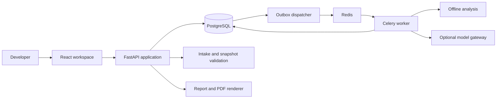

# Basira plan

The single source of truth for what Basira is, what is built, what is next, and how each piece is accepted. Everything else in the repo supports this file. Edited on 27 November 2026.

Contents: [1 Product](#1-product) · [2 Current position](#2-current-position) · [3 Phases](#3-phases) · [4 Phase details](#4-phase-details) · [5 Architecture](#5-architecture) · [6 Agents, tools, memory](#6-agents-tools-and-memory) · [7 Contracts](#7-contracts) · [8 Acceptance](#8-acceptance) · [9 Risks](#9-risks-and-limits) · [10 Decisions](#10-decisions) · [11 Conventions](#11-conventions)

## 1. Product

**Basira (بصيرة)** is a multi-agent web security review workspace. A developer gives it a project (ZIP, authorized GitHub repository, approved website pages, or captured evidence), watches named agents work on it live, and gets an evidence-linked report in Arabic or English, with repair guidance and a recheck after the fix.

Tagline from the blueprint: Detect. Verify. Remediate. Secure.

| Audience | Job | Evidence it works |
|---|---|---|
| Individual developer (first audience) | Review a change or release with no setup | Starts a review, sees what each agent did, gets a next action or an explicit coverage limit |
| Reviewer | Check why a finding appeared and record a decision | Opens the source location, tool and snapshot, records a decision apart from the technical finding |
| Local operator | Keep the install repeatable and recoverable | Installs from the documented profile, restores a backup, report digests match |
| Small team (hypothesis) | Share reviews | Only after demand and the ownership model are validated |

Principles: no manual steps beyond one permission statement; every input accepted in more than one way; findings only with verified evidence; Arabic and English share the same facts; the report works with no model provider; nothing is called accurate until measured; unsupported coverage is shown as a gap, never as clean.

Analysis modes:

| Mode | Inputs | Limits |
|---|---|---|
| White-box | ZIP, GitHub snapshot pinned to a commit, manifests, lockfiles, Docker, Kubernetes, CI, IaC, OpenAPI | Read-only, offline; every source, rule, policy and tool version recorded |
| Passive web | Approved website pages, saved HTTP evidence, HTML, HAR, saved passive ZAP output | Records capture scope; importers do not replay or resolve external references |
| Active verification | Owner-proven sites only | Proposed, see P14 and decision A |
| Remediation | Human-reviewed recommendations, optional approved patch draft | Isolated draft, deployment and merge stay with the human |

## Release 1: scope and future additions

Decision of the owner, 27 Nov 2026: Basira gets a defined release point. Work after it is planned, not current.

**In Release 1 (closes first):**
- P10 redesign slices a to f, with docs and screenshots per slice.
- P20 replay of a stored scan, per-scan request budget check, demo runbook.
- What is already merged: P01 to P09, P21 provider settings, the P19 source-code checks that landed, the P22 self-security tests and the P23 quality gate with CI, the P24 thesis and defense package, the Basira rename.
- P18 reduced to a release checklist: tests green, docs match the running app, Docker status stated as verified or not, no secrets in the repo, release notes.

**Future additions (planned updates after Release 1, not current work):**
- P13 help and report assistant (the cited, read-only chatbot).
- P11 recheck and history, P12 remediation drafts, P15 learning from past scans.
- P14 active verification for owner-proven sites.
- P16 performance and data design work beyond the numbers already measured.
- P17 full four-configuration evaluation (needs the free-tier request cap to allow it).
- P19 further vulnerability classes beyond those shipped.

### How each future addition would be built

None of this is built. Each entry gives the approach, the steps in order, what it depends on, and what counts as done. The longer design notes for each are in section 4 under the same phase number. Dependencies marked "exists" are in the code today.

**P11 Recheck and history.** Approach: reuse the finding fingerprint (a digest of rule, path, line and evidence, already stored per finding) and the existing scan comparison; add an outcome per finding between two scans of the same project. Steps: (1) define the equivalence of scope between two scans (same input kind, same tool set and rule versions, otherwise the outcome is Inconclusive); (2) compute outcomes server-side from the two frozen reports, never in the browser; (3) store the outcome with both scan IDs; (4) show it on the report and on the scan history; (5) add a "Recheck" button that pre-fills a new scan for the same source. Depends on: stored reports and fingerprints (exist), the frozen report model (P09). Done when: the two-ZIP demo gives Fixed, a missing-file fixture gives Inconclusive, and a test proves missing coverage never gives Fixed.

**P13 Report assistant.** Approach: retrieval over the structured report, not over free text; the model only phrases an answer from records it is given, and every citation is checked against the report. Steps: (1) static bilingual help pages, no provider; (2) a local question classifier with a fixed set of intents; (3) a retrieval layer that returns redacted finding, evidence and coverage records for one project report; (4) answer through the provider gateway with only that projection; (5) citation validator that drops any answer with an unknown ID; (6) abstain path; (7) a labeled question set in both languages scored for grounding, correctness and abstention. Depends on: provider settings (P21, exists), gateway (exists), frozen report model (P09) and P11 outcomes if it should answer recheck questions. Done when: the tests listed under P13 pass and the question set has recorded scores.

**P12 Remediation.** Approach: the human decides, the system drafts. Steps: (1) repair plan text per finding from the rule's remediation field (exists in reports); (2) an approval record bound to source digest, plan digest, permitted paths and expiry; (3) an isolated worktree run through the same spool-and-worker pattern the analyzers use, with no network; (4) run only pre-vetted checks on the patch; (5) show a diff for review; (6) reject, roll back or export; no push, merge or deploy. Depends on: P11 (to confirm a patch removes the finding), the offline worker (exists). Done when: one labeled fixture goes from finding to reviewed patch to a recheck that reports Fixed, and the approval cannot be reused after the source changes.

**P15 Learning from past scans.** Approach: statistics over owner decisions and recheck outcomes, never a model rewriting findings. Steps: (1) record decisions as labels per rule and fingerprint (decisions exist, labels need a view); (2) per-rule precision with a minimum sample and an interval; (3) use it only to order and to show a confidence note; (4) carry earlier owner decisions forward when the fingerprint repeats and the evidence is unchanged; (5) replay on held-out scans before enabling. Depends on: P11 outcomes, scan memory (exists in `backend/scan_memory.py`), P17 corpus for held-out data. Done when: the replay shows a gain or is published as no gain, and every ranking change carries a version.

**P14 Active verification.** Approach: opt-in, owner-verified, non-destructive. Steps: (1) ownership proof by DNS TXT record or a token file; (2) a probe allowlist with a rate limit per target and a kill switch; (3) probes as separate tools in the pinned tool registry so their output uses the same evidence contract; (4) a full audit record per request sent; (5) refusal for any target without a valid proof, tested; (6) start with three probes (security headers behavior, exposed files, open redirect). Depends on: the pinned tool registry and evidence contract (exist), the authorization rules in the thesis package (P24), the owner's confirmation of decision A. Done when: an unverified target is refused in a test, a verified local fixture is probed within its rate limit, and the audit lists every request.

**P16 Performance and data design.** Approach: measure first. Steps: (1) baseline p50 and p95 for queue wait, scan time and report time on a fixed set of inputs; (2) profile; (3) digest-keyed caches and incremental scans; (4) event streaming instead of polling for the live view; (5) index and schema review with `EXPLAIN` kept as evidence; (6) load test and compare to the baseline. Depends on: nothing new; P09 events help step 4. Done when: before and after numbers are in the release notes and no test is slower than its budget.

**P17 Full evaluation.** Approach: the harness exists (`backend/detection_experiment.py`); the limit is the free-tier request cap, not the code. Steps: (1) run configurations three and four when the daily cap allows, logging every run; (2) add the 24-case holdout; (3) record precision with the detection rate (P23); (4) write the results with every limit stated. Depends on: a free model quota or an owner-approved alternative; any paid route needs the owner's explicit approval. Done when: all four configurations have logged runs on the same inputs, or the report says which were not run and why.

**Further P19 classes.** Approach: add one class at a time, each with a vulnerable and a safe fixture written for the project, then measure on DVWA again. Order by measured gap and by how detectable the class is from one file: template output, authorization and brute-force patterns, NoSQL injection, then cross-function and cross-file flow. Steps per class: research the pattern, write fixtures, write the check, record precision and recall, update the taxonomy mapping. Depends on: the existing source-code adapter. Done when each class has fixtures, a recorded result, and a taxonomy entry that no longer shows a gap.

A future addition may be started early only if Release 1 is complete, or if it blocks a Release 1 item.

## 2. Current position

Phases P01 to P08 are built; this plan has 24 phases (P01 to P24). P09 has its model lane in place; **work is in P10** (redesign), then P20. Release 1 scope is defined above; everything else is a future addition.

Verified on 27 November 2026:
- Python 3.13: 251 backend tests pass, 1 skipped.
- Real stack without containers (PostgreSQL 17, Redis 7.2, API, dispatcher, Celery worker, Chromium): personal-projects browser acceptance passed in Arabic and English, covering ZIP scan, report, PDF export and cross-account isolation.
- Local lab starts with `npm start`; UI, `/demo` and `/api/taxonomy` respond.
- Not run: Docker image build and Compose, `tests/container_smoke.py`, the other browser suites, real model provider calls, S3 intake.

Measured gaps:
- Scan page shows one "Queued" entry, no per-agent view.
- All 114 checks are passive. 31 of 75 taxonomy subdomains have no check ([taxonomy](taxonomy.md)). Source-code checks read one file at a time.
- Anonymous lab (`/demo`) and organization compatibility keys still exist.
- No accuracy number exists. No benchmark has been run.

## 3. Phases

Status: **done** (built, tests exist, acceptance re-run or re-checked on 27 November 2026 unless noted), **partial**, **open**, **proposed** (needs an owner decision).

| ID | Phase | Scope | Status |
|---|---|---|---|
| P01 | Foundations | Agent roles and contracts, rule registry, evidence-verified output, file selection | done |
| P02 | Reports and export | Report pages, Arabic and English HTML, JSON, PDF, comparison, comments, finding statuses | done |
| P03 | Platform core | Local accounts, OIDC, PostgreSQL with row-level security, Redis and Celery with outbox and leases | done |
| P04 | Detection catalog | 100 checks in six families, vulnerability taxonomy and API, input adapters | done |
| P05 | Evidence and provenance | Evidence contracts, source analysis, evidence links, web and API evidence | done |
| P06 | Intake | ZIP, GitHub App, approved website pages, HAR, ZAP and OpenAPI import, quarantine lifecycle | done |
| P07 | Tools, agents and memory | Pinned tool registry, offline execution, five-stage graph, model gateway and advisor, checkpoints, scan memory | partial |
| P08 | Product journey | Personal projects workspace, ownership migration, project pages | done |
| P09 | Live experience and report model | Per-agent live view, frozen report model, report and PDF parity tests | in progress: slice (a) tokens done |
| P10 | Redesign: UI/UX, fewer steps, automation | Design system, single-screen Scan flow, live view, decision-first report, dashboard, landing; 10 actions to 3 | open (current) |
| P11 | Recheck and history | Fixed, Still present, New, Changed, Inconclusive, Needs review | future (after Release 1) (open) |
| P12 | Remediation | Repair plans, approval, optional sandbox patch draft | future (after Release 1) (open) |
| P13 | Help and report assistant | Static contextual help, then the cited read-only report assistant (committed) | future (after Release 1) (open) |
| P14 | Active verification | Owner-proven, rate-limited, non-destructive probes for the taxonomy gaps | future (after Release 1) (proposed) |
| P15 | Learning from past scans | Owner decisions and recheck outcomes feed ranking, confidence and suppression, measured before it is enabled | future (after Release 1) (open) |
| P16 | Performance and data design | Latency budgets, incremental scans, caching, indexes, schema review, load tests | future (after Release 1) (open) |
| P17 | Evaluation | Benchmarks, labeled corpus, four-configuration comparison with measured detection rates | future (after Release 1) (open) |
| P19 | Coverage expansion and project review | Source-code analysis checks for PHP, JavaScript and Python, then research which classes are realistically detectable, close the cheap gaps in the 75-subdomain taxonomy, review what exists against evidence and list real improvements | partial: 14 source-code checks (`SRC-01` to `SRC-14`, [source-code](checks/source-code.md)) built and measured, DVWA 8 of 13 (was 0 of 13), 1 of 13 fixed files flagged. Open: cross-function and cross-file flow, NoSQL, authorization and brute-force classes, template output, the remaining 31 taxonomy gaps |
| P20 | Demo reliability | Runbook ([DEMO.md](DEMO.md)), per-scan request budget check, replay of a stored scan in the live UI, presentation dashboard; graduation demo is live in front of a professor | partial: runbook written; per-scan request budget check and replay of a stored scan built and tested (see [DEMO.md](DEMO.md), "Built in P20"); open: presentation dashboard (P10 slice e), rehearsal on the demo machine |
| P21 | Provider-agnostic model settings | Settings page: choose a preset provider (OpenRouter, OpenAI, Anthropic, Google Gemini) or add a custom OpenAI-compatible provider by base URL (https, public host only, checked against private and internal addresses, checked again at request time), paste key, list that provider's models, pick one; warning and acknowledgement before any non-free model; free default path stays OpenRouter free models; keys encrypted server-side and masked in the UI | done in code: adapters, gateway routing, storage (`provider`, `base_url`; migration 0016) and settings UI with cost acknowledgement; tested with fakes and a mocked-API browser run, not against live OpenAI, Anthropic or Gemini. Open: show the provider in the scan report, org-level settings UI is still OpenRouter-only |
| P22 | Self-security | Basira scanned by itself; scanned content treated as untrusted input to the agents (prompt-injection tests); key storage, custom-provider URL and export paths reviewed; threat model written | in progress: 56 offline tests for prompt injection, SSRF, DNS rebinding and key handling pass (`backend/test_self_security.py`), threat model table in ARCHITECTURE; upload limits and HTML/JSON export paths covered by 29 more tests (`backend/test_upload_and_export.py`); self-scan with the built-in checks before P19: 166 text files, 0 findings; with the P19 source checks: 185 text files, 3 findings (CI-01, actions not pinned to a commit), fixed by pinning, now 0; model-supplied regex in `search_code` now runs in a child process with a 2 s limit (the shape check alone let `(a|aa)+$` run past 20 s); hostile text in the PDF export tested (no active PDF objects; the test found that NUL passed through `printable`, fixed); self-scan with external tools run on 27 Nov 2026: gitleaks 0 leaks in git history, pip-audit 0 known vulnerabilities, semgrep 2 and bandit 10 medium findings, all reviewed by hand and none exploitable (details in ARCHITECTURE); SARIF export was rejected by the owner on 27 Nov 2026 and is out of scope; open: add the external tools to CI |
| P23 | Quality gates | Precision and false-positive rate measured with the detection recall; a regression gate in CI that fails when either drops; flaky-test policy; reproducible evaluation script | in progress: `python -m backend.quality_gate` records precision, recall and false-positive rate for the reference corpus and DVWA against `tests/fixtures/quality-baseline.json` and exits 1 on a drop; policy in [QUALITY.md](QUALITY.md); CI runs it (not yet seen on GitHub); the model configuration C2 is gated from its recorded run, scored offline: 8 of 13 found, precision 0.25, 5 of 13 clean files flagged (development score), so the gate holds the scoring and the recorded file; open: gates for C3 and C4 once they have a recorded run |
| P24 | Thesis and defense package | Problem statement, related work (from `research/competitors.md`), architecture, evaluation chapter with limits, ethics and authorization rules for scanning, a small usability check with real users, slides, demo script, prepared answers to likely questions | partial: eight files in [thesis](thesis/README.md) (chapters, slides outline, 18 prepared answers); open: usability check with five real users, evaluation chapter update when C3 and C4 run, the slide deck file |
| P18 | Hardening and release | Isolation and recovery acceptance, Docker verified, legacy removal, release manifest, rename | open |

Order of work, set by the agent as the expert (owner delegated sequencing, 27 Nov 2026): P21 (provider settings, done), P09 model lane (done), P10 redesign slices a to f (current, the owner is waiting for it), then P20 (replay and budget check), P19 (source-code checks, the biggest measured gap), P11, P17 and P23 (measured evaluation with precision, when the free-tier cap allows), P13, P16, P15, P22, P07 gaps, P12, P24, P18. P14 follows decision A and ships before P17 if approved, so evaluation covers it.

Release 1 closes first (see Release 1 above): P10, P20, then the P18 release checklist. The rest of this order applies to future additions.

## 4. Phase details

### Built (P01 to P08), with the evidence

| Area | What exists | Where |
|---|---|---|
| Detection | 114 checks, seven families (HTML, Web headers and cookies, Dependencies, Infrastructure, CI, App config, and 14 source-code checks added in P19) | `backend/checks/`, `backend/artifact_review.py`, [checks](checks/README.md) |
| Taxonomy | 17 domains, 75 subdomains, 159 problems, mapped to CWE, OWASP Top 10:2025, OWASP API Top 10 2023, WSTG | `backend/taxonomy.py`, [taxonomy](taxonomy.md) |
| Tools | Gitleaks 8.30.1 and OSV-Scanner 2.7.1 pinned, offline; saved ZAP and OpenAPI import | `backend/source_adapters.py`, `Dockerfile` |
| Workflow | Five stages in LangGraph, parallel branches that merge before verification, deterministic fallback | `backend/graph.py`, `backend/offline_worker.py` |
| Model | Optional OpenRouter through a separate gateway, strict schemas, invalid citations rejected | `backend/model_gateway.py`, `backend/model_connections.py` |
| Memory | Six types, recovery checkpoints bound to owner, project, lease and digests | `backend/scan_memory.py`, [architecture](ARCHITECTURE.md) |
| Platform | Accounts, OIDC, RLS, outbox, Celery, GitHub App | `backend/platform_*.py`, `backend/personal_*.py`, [platform](PLATFORM.md) |
| Reports | HTML (ar, en), JSON, PDF with embedded Arabic font, comparison, comments | `backend/report_pdf.py`, `backend/advanced_reporting.py` |
| Evaluation | Synthetic corpus (18 cases), reference corpus manifest, analyzer baseline | `backend/synthetic_evaluation.py`, `backend/corpus_evaluation.py`, `backend/analyzer_baseline.py`, [release](RELEASE.md) |
| Research | 72 competing tools, benchmark survey | [competitors](research/competitors.md), [benchmarks](research/benchmarks.md) |

Open items inside P07: failure and recovery acceptance (crash after checkpoint, before publish), worker isolation acceptance with controlled egress, preflight reasons for unsupported files.

### P09 Live experience and report model

1. Live agent view. Shipped so far: the scan page lists the five roles with state, duration and tools used, from persisted `agent_done` events (`frontend/src/AgentLanes.jsx`). The model stage now has its own lane that shows Running while the one model request is in flight (`stage_start` then `agent_done`, written only by the current lease holder). The five analysis roles now report when they start, live: the isolated worker appends the role name to a progress file in the spool, and the job runner turns each line into an `agent_start` event while the analysis runs (no network, no new privileges for the worker). The scan page shows a pipeline board with a progress bar and a "now" line; a role counts as done when a later role has started or its `agent_done` arrives. Durations still arrive with `agent_done` after the analysis step ends. Still open: per-tool progress, and a longer-running input to confirm the live updates on a real slow scan (the screenshot used a real scan with its events cut at the analysis step, so the running state is simulated by that cut). Target design: lanes for the five roles with state (waiting, running, done, skipped, failed), current task, tool in use, items done and remaining, elapsed time and evidence produced. Fed by persisted stage events with a cursor. Percentages only with a real denominator; stale data is shown as stale.
2. Frozen `ReportModel` per scan (section 7), rendered to web, Arabic and English text, and PDF. A cross-format test compares finding IDs, severity totals, evidence IDs and coverage.
3. PDF tests for shaping, mixed direction, long paths, many pages and selectable Arabic text.
4. Intake accepts drag and drop, file picker, paste and URL.

Done when: scan page shows each role live in a browser test, and the parity test passes in both languages.

### P10 Redesign: new UI/UX, fewer steps, more automation (now the current phase)

The owner asked for a radical redesign: easier flows, less manual work, more automation. It moves ahead of P20 and P19 in the order of work because it changes what every later feature looks like.

**Measured starting point (27 Nov 2026, personal mode, Arabic UI).** Counted from the scripted tour, after the account exists: New Project, type the project name, Create project, New scan, Continue to source, choose the file, Review scan, tick the permission, Submit, Open report. That is 10 user actions across 5 screens before the report opens. Target: 3 actions on one screen (drop the file, tick the permission, Start), with the project chosen automatically and the report opening when the scan ends.

**Principles.** One primary action per screen. Detect, do not ask: input type from the file, project from the last one used (or an automatic "My scans" project in personal mode). Defaults that are safe. Details on demand. Every state designed: empty, loading, partial, error, no permission, stale. Arabic first, RTL native, English complete. Severity is always a word as well as a color. Honest numbers only; a figure without a real denominator is not shown.

**Flows.**
1. Start: one "Scan" screen. A large drop zone (file, paste, GitHub or approved page URL tabs). On drop: input type detected, scope summary shown inline (what will and will not be read), one consent checkbox, one Start button. The consent checkbox, idempotency key and scope check stay; only the extra screens go.
2. Live: the five agents and the model lane as a pipeline with real events, elapsed time and what each produced; the page opens the report on completion (with a Stay option) and shows a plain error with a Retry on failure.
3. Report: first screen is the decision, not the table: counts by severity, the three things to fix first with the reason, coverage and what was not checked. Then findings, step-by-step mode, evidence, export menu (PDF, JSON).
4. Dashboard: scans over time, new and fixed since the last scan (by finding fingerprint), freshness stamp on every number, each number traceable to its scan.
5. Automation backlog, in order: auto-open report (done, 4 s countdown with Stay); skip the project step and open the review as soon as a file is chosen (done for personal mode: after the project exists the flow is New scan, choose file, tick permission, Submit = 4 actions, measured in a real browser, down from 8; the target of 3 needs the automatic default project, still open); remember last project and input type; saved scan presets; one-click replay of a stored scan (P20); recheck after a fix (P11); scan on push for a connected repository.

**Design system.** Tokens first (color, type scale, spacing, radius, elevation, motion with reduced-motion respected), built on the existing dark and light themes, with the blueprint palette. Components get one definition each: button, field, card, status chip, severity chip, lane, empty state, toast. Pages are migrated one at a time so main stays shippable.

**Design direction (chosen by the owner, 27 Nov 2026): "Pop".** Chosen from four animated concepts (Aurora, Pop, Signal, Cobalt) after the first navy/teal tokens and ten grey layouts were rejected. Rules: 60/30/10 colour (cream canvas 60%, ink indigo for type, lines and shadows 30%, accents tomato, lemon, mint, lilac and sky 10%); type: Cairo Black for headings, IBM Plex Sans Arabic (Arabic) and Inter (English) for body; 3 px ink borders, offset shadows, round shapes, springy motion (bounce, wobble, float, marquee), all of it off under `prefers-reduced-motion`. Dark theme keeps the same accents on deep indigo. Tokens are in `frontend/src/workspace.css`; shapes and motion in `frontend/src/design-pop.css`, loaded last. **Slice (a) status:** applied to landing, workspace shell, projects, scan flow, report and settings as a style layer. The structural changes (live view, decision-first report, dashboard, one-screen scan) are slices c to f and will be built in this style. Contrast: body text pairs were chosen from the ink on cream pair; white or ink text on tomato and lemon tiles was not formally measured, and no automated accessibility audit was run.

**Slice (d) status (27 Nov 2026).** The report now opens with a Decision block: the headline ("N fixes before handover" or "No findings in what was checked"), the top three fixes by severity with file and line, rules run out of rules in coverage with a link to what was not checked, and a standing caution that no findings is not proof of a clean project. Counts come from the stored report only. Checked in a real browser (personal projects acceptance); Arabic checked visually; the other Playwright suites were not re-run.

**Slices, each a small PR to main.** (a) tokens and shared components; (b) single-screen Scan flow; (c) live view and auto-open; (d) decision-first report; (e) dashboard; (f) landing and sign-in. After each slice: screenshots in Arabic and English, dark and light, and a before/after action count.

Done when: the 3-action flow passes the browser test in both languages, every route has screenshots in both languages and both themes, keyboard use works on the Scan, live and report screens, and each dashboard number reconciles with its scan records. Not claimed: any accessibility audit by a tool, unless one is run and recorded.

### P11 Recheck and history

Compare the original report with a recheck of the new revision under an equivalent scope. Outcomes: Fixed (comparable evidence eligible, check executed, result supports the fix), Still present, New, Changed, Inconclusive (missing input, eligibility or tool success), Needs review (conflicting or ambiguous identity). Missing coverage never yields Fixed. Done when the two-ZIP demo and a missing-file fixture give Fixed and Inconclusive.

### P12 Remediation

Recommendation from a validated finding, repair plan, owner approval bound to source digest, plan digest, permitted paths and expiry. Optional draft in an isolated worktree, trusted pre-vetted checks, review, reject or roll back. Deployment, push and merge are never automatic. Ships behind a flag, one labeled fixture first. States: Proposed, Awaiting approval, Approved, Sandbox created, Patch drafted, Testing, Ready for review, Completed; plus Rejected, Failed, Rolled back.

### P13 Help and report assistant

Committed by the owner. Scope, so it stays safe and useful:
1. Static bilingual help works with no provider.
2. The report assistant is read-only and bound to one project report. It classifies the question locally, retrieves redacted structured records (findings, evidence, coverage, recheck outcomes), and answers from them with citation IDs. A model may phrase the answer but receives only the approved projection and cannot add facts; every citation is validated against the report, otherwise the answer is dropped.
3. It abstains when no approved source matches, says so, and points to the nearest finding or help page.
4. Session-only memory by default; nothing persisted unless the owner opts in. It cannot start scans, change decisions, or touch other projects.
5. It is measured: a labeled question set with grounding, correctness and abstention scores, in both languages.

Done when: authorization, unsupported-question, invalid-citation and provider-down tests pass and the question set is scored.

### P14 Active verification (proposed)

For sites the owner proves they control (DNS TXT record or a file token): bounded, rate-limited, non-destructive probes for the largest taxonomy gaps (reflected XSS, SQL injection signals, open redirect, exposed files, CORS and header behavior, TLS, rate limit presence). Allowlist per probe, kill switch, full audit, safe by default. Findings enter the same evidence contract. Not started. Needs decision A.

### P15 Learning from past scans

The system improves from its own history without letting a model rewrite findings. Three loops, each off until measured on held-out data:
1. Ranking and confidence calibration. Owner decisions (accepted risk, false positive, fixed) and recheck outcomes become labels per rule and per finding fingerprint. A per-rule precision estimate (with a minimum sample size and a confidence interval) adjusts confidence and ordering, never the existence of a finding.
2. Project memory. Repeated fingerprints are recognized across scans; a decision the owner made earlier is offered again, marked as carried over, and expires when the evidence changes.
3. Corpus growth. Confirmed true and false positives (redacted, with consent) are added to the regression corpus so every rule change is scored against them.
Rule changes stay human-approved and versioned. Done when a replay on held-out scans shows the calibrated ranking beats the static one (or the result is reported as no gain) and nothing changes without a recorded version.

### P16 Performance and data design

Targets are set from a measured baseline, not guessed. Work: profile the scan path; incremental scans that skip files whose digest and rule versions are unchanged; cache artifact inventories and parsed manifests by digest; stream stage events instead of polling; parallel analysis branches within the worker budget; report and PDF rendering cached by report version; index review for every hot query (`EXPLAIN` evidence kept); schema review against [ERD](ERD.md): keys, constraints, retention, partitioning decisions for events and findings; load test with many projects and large archives, reporting p50 and p95 for queue wait, scan time and report time. Done when baseline and after numbers are recorded in the release notes and no regression test is slower than its budget.

### P17 Evaluation

Fixed test targets, same inputs for every configuration: (1) static checks only, (2) one agent with no tools, (3) multiple agents with no tools, (4) multiple agents with tools. Measure detection rate (share of labeled vulnerabilities found), false positives, duplicates, runtime and cost, and show the progression from 1 to 4. Targets: vulnerable apps and benchmarks listed in [benchmarks](research/benchmarks.md), plus at least 24 independently labeled holdout cases (12 clean, 12 positive) for the passive scope. Configurations (2) to (4) need a model provider; without one only (1) and the deterministic tool runs can be measured, and the report says so. Model: no paid spend is authorized (owner decision 27 November 2026), so agent configurations use one free OpenRouter model. Chosen from the live OpenRouter model list (`https://openrouter.ai/api/v1/models`, 13 free models on 27 November 2026): `nvidia/nemotron-3-ultra-550b-a55b:free`, the largest free model with tool calling, 1M context. The same model, prompts, temperature and token limits are used in configurations 2 to 4 and are recorded with the results. Free tiers are rate limited and the model can change or disappear, so every run stores the model ID, date and request log. Scoring unit: a labeled vulnerability is a (target file, taxonomy subdomain) pair. The 12-case reference corpus was written together with the checks, so a static score on it proves little; it stays as a regression set, and the headline numbers come from independent targets with a published vulnerability list (for example DVWA and OWASP NodeGoat source), labels mapped to taxonomy subdomains by two readers before any run.
Published comparisons with other systems use only their own published numbers, with source and benchmark version, and are marked as not like-for-like unless the same target and scoring are used. A zero or negative result is reported as is. Nothing is published before a run.

### P22 Self-security

Basira reads untrusted files and sends parts of them to language models, so it is itself a target. Work: run Basira on its own repository and fix real findings; tests where scanned content contains instructions aimed at the agents (the agents must treat it as data and never change tools, scope or output format because of it); review the key store (encryption, masking, no logging), the custom-provider URL checks at request time (DNS rebinding), upload limits and export paths; write the threat model in ARCHITECTURE. Done when the tests exist, pass and are part of CI.

### P23 Quality gates

Detection rate alone rewards noisy tools. Each evaluation run also records precision and false-positive rate per configuration; the one-agent run already flagged 5 of 13 fixed files, so this matters. A CI gate compares the stored baseline and fails on a drop; the evaluation script reproduces every published number from pinned inputs; flaky tests are fixed or quarantined with an owner.

### P24 Thesis and defense package

Deliverables: problem statement and scope; related work using the 72-tool survey; architecture and data design chapters; evaluation chapter with every limit stated (one labeler, one model, free-tier runs); ethics and authorization rules (active probing only for owner-proven targets); a usability check with five real users and their results; slides; the demo script from [DEMO.md](DEMO.md); a list of likely professor questions with evidence-backed answers. Done when a person who has not seen the project can follow the chapters and reproduce the numbers.

### P18 Hardening and release

Failure injection (crash at dispatch, after checkpoint, before publish), duplicate dispatch, stale lease, cancel; isolation with controlled egress; restore on a copied database with matching digests; Docker image and Compose verified on a real Docker host; merge ARCHITECTURE, PLATFORM and WORKSPACE into fewer topic files (translate if the owner asks); remove `/demo`, remaining organization keys and legacy report compatibility after a verified migration; release manifest with hashes and known limits; go or no-go record; rename if decided.

**Release 1 checklist, including the documentation audit (requested by the owner, 27 Nov 2026).** The audit is run and its results are written into `docs/RELEASE.md` with the checklist; each item is marked passed, failed or not run, with the command or file that shows it.
1. Tests: backend suite green; browser suites run and listed by name; anything not run is stated.
2. Documentation audit: (a) everything done is recorded in this plan with its status; (b) `docs/RELEASE.md` is current; (c) every number in `docs/thesis` and `docs/QUALITY.md` matches the measured source on main; (d) naming is consistent (Basira, `BASIRA_*`, `basira_*`, no stale Marsad outside history and redirects); (e) no stale or contradicting docs, checked by comparing README, DEMO and WORKSPACE against the running app; (f) all links resolve.
3. Docker: stated as verified or not verified.
4. No secrets in the repo or history.
5. Release notes and known limits.

## 5. Architecture

The database is authoritative for work state and reports. The broker only transports jobs. A stale lease cannot publish. Provider calls happen after deterministic verification and receive a minimized projection.

| Concern | Decision |
|---|---|
| Web | React, Vite, Arabic and English, RTL and LTR, dark and light |
| API | Python 3.13, FastAPI, Pydantic; routes under `/api/platform` |
| Data | PostgreSQL 17, SQLAlchemy, Alembic, row-level security; SQLite only for the anonymous lab until it is removed in P18 |
| Jobs | Redis, Celery, transactional outbox, leases, bounded retries |
| Agents | LangGraph, five deterministic stages |
| PDF | fpdf2, uharfbuzz, embedded Arabic font |
| Deploy | Local lab, Docker Compose; pytest and Playwright |

ZIP limits: 2,000,000 bytes per archive, 8,000,000 expanded, 1,000,000 per file, 200 entries. Details: [architecture](ARCHITECTURE.md), [data model](ERD.md), [operations](PLATFORM.md), [workspace](WORKSPACE.md).

## 6. Agents, tools and memory

Five stages run in order. They are responsibilities, not model calls; queueing, auth, export, tool dispatch and proof validation are ordinary services.

| Role | Reads | Writes | Denied |
|---|---|---|---|
| Coordinator | Snapshot envelope, approved source identity, limits | Source kind, routing decision | Scope or digest mismatch |
| Planning | Source kind, artifact inventory, pinned policy and registry | Immutable tool selection with reason, expected coverage | Model-originated commands, network, installs |
| Analysis | Matched artifacts, allowlisted adapters | Candidate findings, per-tool status and coverage | Network, project code execution, writes |
| Verification | Artifacts, plan, candidates, results | Validated findings, evidence digest | Invalid scope, path, position or rule cannot publish |
| Reporting | Validated findings, scope, coverage | `ReportModel` and projections | Publishing a provisional result |

Role manifests carry ID, typed input and output, allowed tools, budgets, failure behavior and fixtures. The ten-role specialist catalogue (injection, authentication, authorization, API, client, infrastructure, file, business logic, remediation, coordinator) is a design target. A role is added only when it fills a named gap and beats the simpler alternative on held-out fixtures at equal budget.

Memory: working state (job service, cleared after terminal state), episodic (published scans and reports), procedural (versioned rules and tool registry), project (owner notes, never sent to a model by default), finding and review (fingerprints, human decisions separate), semantic (curated help, proposed), conversational (session only, proposed). Every record carries owner and project; the app authorizes before the query and at delivery; RLS is defense in depth.

Tools: each analyzer needs a registry entry, license review, pinned version and data, positive and negative fixtures, offline isolation, normalized output and partial-failure behavior. Semgrep CE and Trivy stay shadow-only.

## 7. Contracts

**ReportModel** (frozen at publication): `report_version`, scan ID, source and scope digests, policy version, tool manifest digest, state, timestamps, findings, evidence references, severity totals, coverage. Translated text is separate from the technical record. Old reports are read through a compatibility adapter; unknown legacy fields stay unknown.

**Coverage states:** registered, eligible, executed, matched or clear, skipped, error, requires context, not applicable. Only executed and eligible checks count as clear.

**Finding:** ID and fingerprint, project, scan, snapshot, title, category, severity (Critical, High, Medium, Low, Informational, with rationale), confidence (evidence strength, independent of severity), verification status, location, rule and tool versions, evidence references, fix, timestamps. Duplicates group by fingerprint and keep each original reference.

**Interaction modes** (stored with the scan): Manual (owner selects and submits), Ask (owner confirms the suggested plan), Agent (owner confirms scope, agents choose eligible checks). A new mode or broader scope is a new request.

**Screens:** welcome and sign-in, projects, project home and dashboard, new review, live scan, findings explorer and finding detail, report, recheck, remediation, help, settings. Each has empty, partial, failure and permission-denied behavior.

## 8. Acceptance

| Gate | Pass condition |
|---|---|
| A1 Scope and intake | Scan starts from a ZIP only after scope is confirmed; invalid archives rejected; a second account cannot read the scan, report or export |
| A2 Execution and evidence | Job ID survives reload; a tool timeout gives a partial report with explicit coverage; duplicate dispatch cannot publish twice |
| A3 Bilingual report | Arabic and English web and PDF match finding IDs, severity totals, evidence IDs and coverage; keyboard-only core flow |
| A4 Recheck | Original and repaired ZIP give Fixed; missing coverage gives Inconclusive |
| A5 Evaluation and handoff | Frozen manifest reproduces the comparison; test summary, digests, known limits and an isolated restore record attached |

Test layers: unit and contracts; database and API with two owners; worker and queue failure injection; browser (Playwright) in both languages; fix and regression; recovery and release. Unit and docs tests run with `npm test`.

## Graduation scope

What makes this graduation-worthy, in priority order: (1) live multi-agent view with real events (P09); (2) a measured four-configuration evaluation with honest numbers (P17); (3) recheck of a fix with Fixed and Inconclusive outcomes (P11); (4) learning from past scans, measured (P15); (5) cited report assistant (P13); (6) performance numbers (P16); (7) active verification for owned sites (P14, if approved); (8) patch draft on one fixture (P12). Items 1 to 3 and 6 are the core; 4, 5, 7 and 8 are added only when their phase gate passes.

## 9. Risks and limits

- Passive checks cannot find injection, XSS, IDOR or SSRF. Until P14 these stay listed as gaps.
- No accuracy is published. The synthetic corpus proves rule behavior, not real-world detection.
- Model-backed configurations in P17 need a provider key and budget; none is configured in the review environment.
- Docker has not been run in the review environment.
- The model is advisory only. It cannot add, remove or rewrite findings.
- Hosted or team use needs a separate design: tenant access, storage, cost and support.

## 10. Decisions

| ID | Decision | Status |
|---|---|---|
| A | Add the owner-verified active verification tier (P14), opt-in, runs only for an owner-verified target | decided 27 November 2026 (owner delegated the call; built in P14) |
| B | Rename the product from Marsad to Basira (بصيرة, insight): repo text, package, UI, docs, tests applied in one change; the GitHub repository is renamed after the change merges | decided 27 November 2026 (owner approved a rename; name chosen by the agent) |
| F | Report assistant stays in scope (owner decision 27 November 2026), read-only and cited | decided |
| C | One tracker, this file; blueprint and repository phase IDs retired | decided 27 November 2026 |
| D | Initial user is the individual developer, local first | decided |
| E | Patch drafting stays behind a flag until gates A3 and A4 pass | decided |

## 11. Conventions

- This file is the only tracker. Do not add phase notes elsewhere. Record shipped changes in `CHANGELOG.md`.
- IDs: phases `P01` to `P16`, gates `A1` to `A5`, decisions letters, rules keep their registry IDs (for example `WEB-05`, `INF-03`).
- Files: Python and docs use lowercase snake_case (`scan_contracts.py`) except `README`, `PLAN`, `CHANGELOG`, `LICENSE`; docs folders use lowercase kebab-case. Names describe what a file does, never when it was written. No phase numbers in file, function or variable names.
- Tests: `backend/test_<module>.py`; browser suites `tests/browser_<what>.py`; fixtures under `tests/fixtures/<what>/`.
- Environment variables start with `BASIRA_`.
- Generated files say so in their header and have a freshness test.
- Documentation language: English for new files; existing Arabic files stay Arabic until translated. The owner decides the language.
